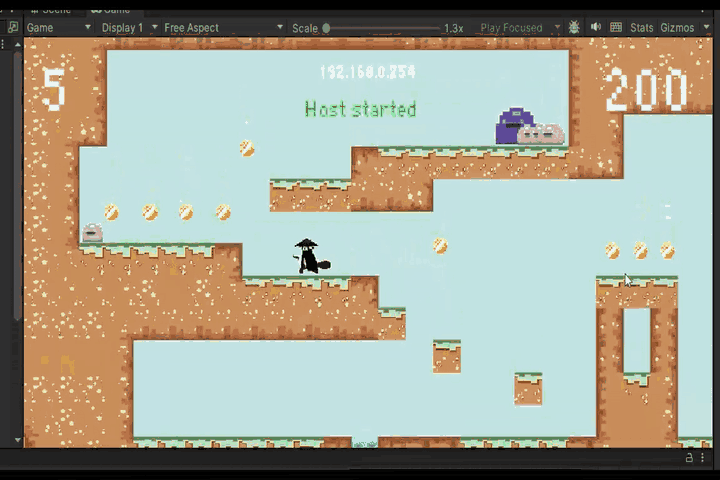
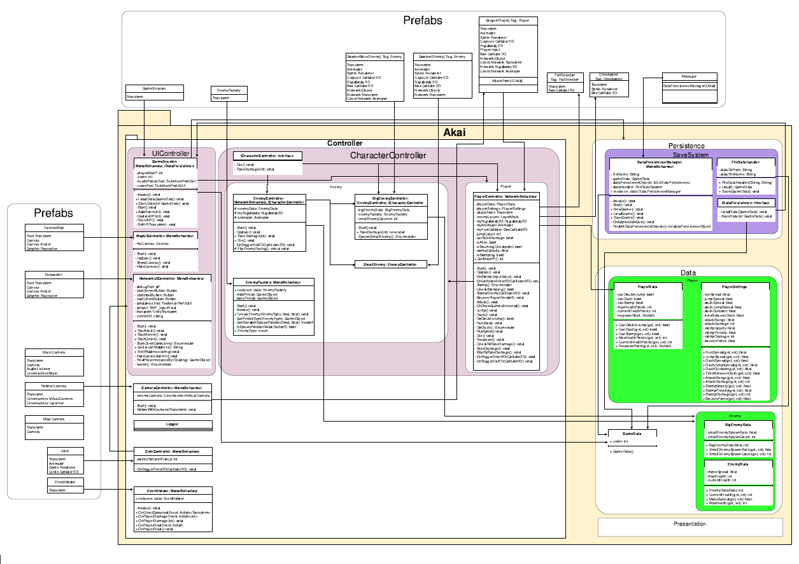

# Akai 2D Unity Game

A 2D co-op platformer built in Unity as part of the course "Software Development 3"
(3rd semester, Media Informatics B.Sc., HdM Stuttgart).

## Overview
The focus of the project was local co-op gameplay and clean software architecture.
Since the course was graded like a software engineering project (e.g. a web application),
the game was structured like a software application rather than a typical game prototype.

- **Team size:** 5 students
- **Duration:** 1 semester / 4-5 months
- **Engine:** Unity 2022.3.12f1, C#

## My Contributions
- **Animation:** [e.g. character animations, Animator state machine, ...]
- **Save system:** [e.g. what is saved, how, format]
- **Attack system:** [e.g. melee/ranged, hitboxes, damage handling, ...]

## Architecture

## Links
- https://www.youtube.com/watch?v=b_sZBPVeBKo
