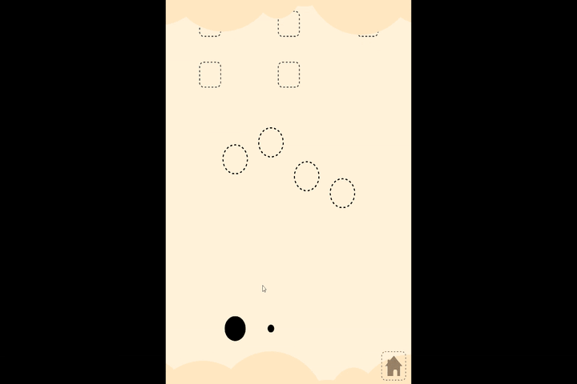

# Erik Lindinger: Portfolio

Hi, I'm Erik. This repository collects my code and Unity projects. Each project has its own folder with its own README, source code, screenshots or GIFs, and a link to a playable build where available.

## About me

- **Background:** 10 years as a trained tool mechanic (Werkzeugmechaniker: CAD, CNC, EDM, mold making), then a Media Informatics B.Sc. at Hochschule der Medien (HdM) Stuttgart
- **Experience:** 3D Artist and Unity Developer on AR/VR projects at Mercedes Tech Innovation, an exchange semester in Groningen, one year in Australia
- **Interests:** real-time 3D, Unity, audio-reactive visuals, IT security
- **Studies combine:** software development, creative media and technical security topics

## Projects

| Project | What it is | Tech | Folder |
|---|---|---|---|
| **AudioVisualizer (Bachelor's thesis)** | Real-time audio analysis and visualization for a music learning app. Five analysis methods implemented from scratch (FFT, STFT, chroma, RMS, onset detection), technical evaluation and a user study (n = 15) | Unity, C#, DSP | [`AudioVisualizer_Bachelor_Thesis`](AudioVisualizer_Bachelor_Thesis) |
| **Akai** | 2D co-op platformer built in a team for the course "Software Development 3". Focus on co-op gameplay and clean software architecture. My parts: animation, save system, attack system | Unity, C# | [`Akai_2D_Unity_Game`](Akai_2D_Unity_Game) |

<!-- Add a screenshot or GIF per project here later, e.g.
 -->

## Where to find what

```
Portfolio/
├── README.md                          <- you are here
├── AudioVisualizer_Bachelor_Thesis/
│   ├── README.md                      project overview, architecture, results
│   ├── AudioFilter/                   audio analysis code (extractors, data structs)
│   ├── AudioVisualizer/               visualization code
│   ├── Evaluation/                    evaluation data and scripts
│   ├── Docs/                          thesis PDF and figures
│   └── Media/                         GIFs and screenshots
└── Akai_2D_Unity_Game/
    └── README.md                      project overview and my contributions
```

**Tip:** if you only have a few minutes, start with the README of each project. They summarize the goal, my role, the technical approach and the results.

## What's in the repository, and what isn't

- The folders contain **only the code and assets I wrote or created myself**, not complete Unity projects. Generated folders (`Library`, `Temp`, etc.) are excluded.
- To run a project, use the **playable builds** under [Releases](https://github.com/Oertschl/Portfolio/releases) instead of setting up Unity.
- Third-party apps and frameworks that my work builds on (for example the Tone app in the thesis) are credited in the project READMEs and are not part of this repository.

## 3D and art work

This repository focuses on code. My 3D art, animation and modeling projects (Blender and others) are on ArtStation: [ArtStation](https://www.artstation.com/oertschl)

## Contact

- Email: [erik.lindinger@gmx.de]
- LinkedIn: [[link](https://www.linkedin.com/in/erik-lindinger-0a2832187)]
- ArtStation: [[link](https://www.artstation.com/oertschl)]
